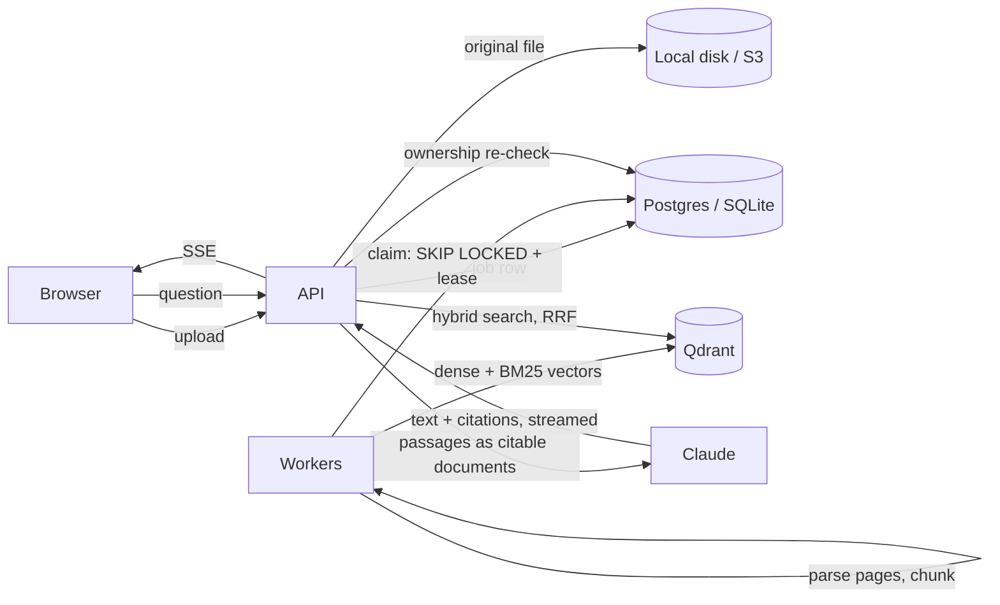

# Citewise

**Ask questions across your documents and get answers you can check: every claim links to the exact passage and page it came from.**

Citewise is a self-hostable document Q&A app. Upload PDFs, Word documents, Markdown or text files; ask questions in plain language; get a streamed answer from Claude where each sentence carries a numbered citation you can click to see the source passage and jump to the page.

- **Native, verifiable citations.** Retrieved passages are sent to Claude as citable documents using the [Citations API](https://platform.claude.com/docs/en/build-with-claude/citations). Claude returns structured citations that point at specific passages, so the app knows exactly which file and page backs each claim. Nothing is parsed out of free text, and the model can't cite a passage it wasn't given.
- **Real page numbers.** Parsing keeps track of pages, and chunks never cross a page or section boundary, so "page 3" really means page 3.
- **Hybrid search, locally.** Dense embeddings (`bge-small-en-v1.5`) plus BM25 sparse vectors, fused with Reciprocal Rank Fusion inside Qdrant. Both run on CPU via fastembed, so **no embedding API key is needed**.
- **A durable ingestion queue.** Postgres `FOR UPDATE SKIP LOCKED` claiming, time-limited leases with heartbeats, automatic recovery from crashed workers, retries with exponential backoff, and permanent-failure detection. Run as many worker processes as you like.
- **Production basics.** JWT access tokens plus rotating refresh tokens with reuse detection, per-user isolation re-checked at the database, streaming upload size limits, content-sniffed file validation, CSP headers, Prometheus metrics, Alembic migrations, Docker Compose, CI.

## Quickstart (local, no Docker)

Requires Python 3.11+.

```bash
python -m venv .venv
.venv/Scripts/activate          # Windows; use `source .venv/bin/activate` on macOS/Linux
pip install -e ".[dev]"
cp .env.example .env            # then set GEMINI_API_KEY (free tier) or ANTHROPIC_API_KEY
python -m citewise serve
```

Open http://localhost:8000, create an account, and drop in a file. `samples/` has a fictional annual report and travel policy to try.

The local setup uses SQLite and an embedded Qdrant under `./data/`, with the worker running inside the API process. The first upload downloads the embedding models (about 100 MB) once.

**Choosing a model.** `CITEWISE_GENERATOR=gemini` uses Google Gemini, which has a free tier ([get a key](https://aistudio.google.com/apikey)). Passages are numbered in the prompt, and the server keeps only `[n]` citations that match a passage it actually sent. `CITEWISE_GENERATOR=claude` uses Claude's native Citations API for the most reliable citations.

**No API key at all?** Set `CITEWISE_GENERATOR=extractive` to run with no LLM at all. Answers become the best-matching passages, quoted verbatim and cited, which is handy for demos and for judging retrieval quality on its own.

## Docker Compose (Postgres + Qdrant + separate workers)

```bash
cp .env.example .env            # set ANTHROPIC_API_KEY and CITEWISE_JWT_SECRET
docker compose up --build
```

This runs migrations, starts the API on :8000, and runs **two worker replicas** pulling from the same queue. The embedding models are baked into the image.

## How it works



**Ingestion.** The upload is content-sniffed (magic bytes, not the client's MIME type), hashed for duplicate detection, stored under a server-generated key, and queued. A worker claims the job atomically, parses it page by page, and splits it into ~1200-character *parent* chunks (what Claude reads and cites) and ~300-character *child* chunks (what gets embedded). Before indexing, it wipes anything a previous attempt left behind, so retries never duplicate data. Originals are kept, so documents can be reprocessed after a failure or a model change.

**Answering.** The question (folded together with the previous one for short follow-ups) runs through dense and BM25 search. Child hits collapse to their parents. Ownership and readiness are re-verified in the database: a vector payload alone never decides what a user may read. The top passages go to Claude as `document` blocks with citations enabled. As the answer streams, each cited text block is numbered `[1]`, `[2]`, …, and those numbers map to file, page and section.

**Resilience.** A worker that dies stops renewing its lease, and another worker reclaims the job once it expires. A worker that loses its lease can't overwrite the new owner's result (fencing on `worker_id`). Unreadable files fail immediately and aren't retried. Deletion is a resumable saga: `DELETING` status, then the vectors, the file, and the rows.

**Model behavior.** Generation uses `claude-opus-5-5` at `medium` effort by default (configurable). Server-side refusal fallbacks are on (`fallbacks: "default"`): if a safety classifier declines, the API continues on a recommended fallback model within the same stream. If the whole chain declines, the partial answer is discarded rather than shown as complete.

## API

Interactive docs: `/api/docs`.

| Method | Path | |
|---|---|---|
| POST | `/api/auth/register`, `/api/auth/login` | Create account / get access + refresh tokens |
| POST | `/api/auth/refresh`, `/api/auth/logout` | Rotate refresh token / revoke the login chain |
| POST | `/api/documents` | Upload (PDF, DOCX, MD, TXT) → `202` |
| GET | `/api/documents?limit&offset&status` | Paginated list |
| GET | `/api/documents/{id}` · `/file` | Status · original file |
| POST | `/api/documents/{id}/reprocess` | Retry a failed document or rebuild a ready one |
| DELETE | `/api/documents/{id}` | Delete document, vectors and file |
| POST/GET | `/api/conversations` | Create / list (paginated) |
| PATCH/DELETE | `/api/conversations/{id}` | Rename / delete |
| GET | `/api/conversations/{id}/messages` | History, with sources |
| POST | `/api/conversations/{id}/messages` | Ask. Streams SSE: `retrieved`, `token`, `cite`, `reset`, `error`, `done` |
| GET | `/api/health`, `/api/ready`, `/metrics` | Liveness, readiness (DB + Qdrant), Prometheus |

## Configuration

All settings are environment variables prefixed `CITEWISE_` (see [`.env.example`](.env.example) and [`citewise/config.py`](citewise/config.py)). The most useful:

| Variable | Default | |
|---|---|---|
| `ANTHROPIC_API_KEY` | | Claude credentials (falls back to the SDK's credential chain) |
| `CITEWISE_ANTHROPIC_MODEL` / `_EFFORT` | `claude-opus-5-5` / `medium` | |
| `CITEWISE_GENERATOR` | `claude` | `gemini`, `claude`, or `extractive` (no LLM) |
| `GEMINI_API_KEY` / `CITEWISE_GEMINI_MODEL` | / `gemini-flash-latest` | Gemini credentials and model |
| `CITEWISE_DATABASE_URL` | SQLite in `./data` | `postgresql+asyncpg://…` for production |
| `CITEWISE_QDRANT_URL` | embedded | URL of a Qdrant server |
| `CITEWISE_STORAGE_BACKEND` | `local` | `s3` (+ `CITEWISE_S3_BUCKET`, `CITEWISE_S3_ENDPOINT_URL`) |
| `CITEWISE_JWT_SECRET` | | **required** when `CITEWISE_ENV=production` |
| `CITEWISE_RUN_WORKER_IN_API` | `true` | set `false` and run `python -m citewise worker` separately |

Changing the embedding model creates a new Qdrant collection, so vector spaces are never mixed. Run `python -m citewise reindex` to queue every document indexed with an older model.

## Development

```bash
pytest                 # 61 tests; offline (hashing embedder, in-memory Qdrant, fake Claude streams)
ruff check citewise tests && ruff format --check citewise tests
alembic revision --autogenerate -m "..."   # after changing citewise/models.py
```

## Limitations

- Scanned PDFs need OCR first; image-only pages have no text to index.
- DOCX files have no reliable page numbers, so their citations point at the section heading instead.
- Access tokens live 15 minutes and aren't individually revocable; logout revokes the refresh-token chain, which ends the session on the next refresh.
- The embedded Qdrant and SQLite setup is for a single process. Use Postgres and a Qdrant server (the Compose setup) for multiple workers.

## License

[MIT](LICENSE)
